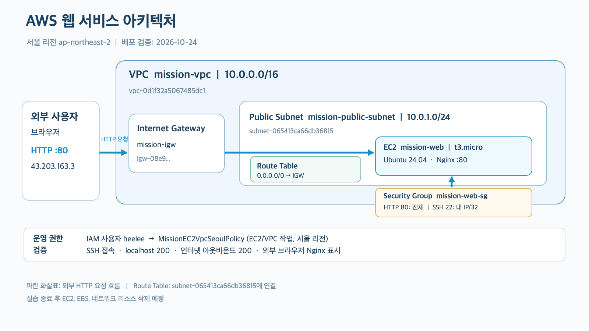
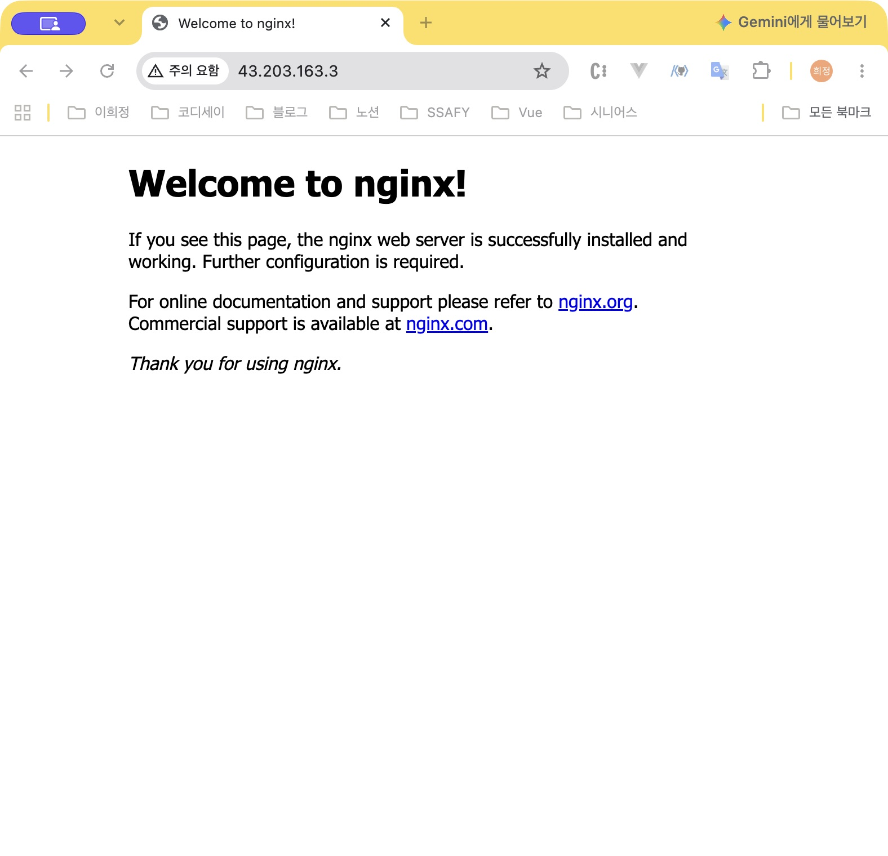
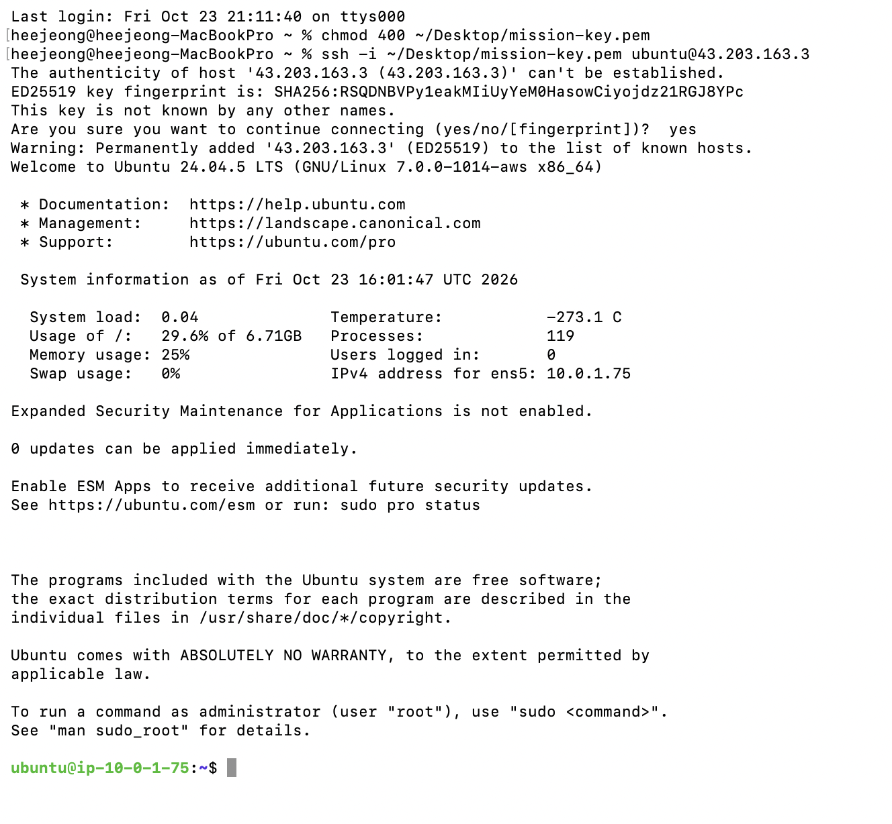
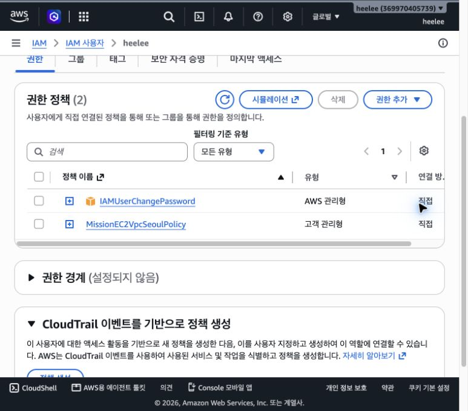

# AWS 웹 서비스 인프라 구축 실습

## 자료 바로 보기

- [아키텍처 구성도](docs/architecture.png)
- [외부 브라우저 접속 캡처](docs/screenshots/external-access.png)
- [SSH 접속 캡처](docs/screenshots/ssh-login.png)
- [IAM 권한 캡처](docs/screenshots/iam-user-permissions.png)
- [트러블슈팅 기록](docs/troubleshooting.md)
- [리소스 정리 체크리스트](docs/cleanup-checklist.md)

### 아키텍처 구성도



### 실습 캡처

**외부 브라우저 접속**



**SSH 접속**



**IAM 사용자 권한**



## 실습 목표

- VPC와 Public Subnet으로 웹 서버용 네트워크를 구성한다.
- EC2에 Nginx를 설치하고 외부 브라우저에서 기본 페이지에 접속한다.
- 보안 그룹으로 HTTP 및 SSH 접근을 제어하고 IAM 최소권한을 적용한다.
- 오류의 증상과 검증 근거를 기록하고 해결 과정을 설명한다.
- 접속 증빙을 확보한 뒤 리소스를 정리하고 종료·삭제 근거를 남긴다.

별도의 애플리케이션 개발 없이 Nginx 기본 페이지를 사용한다. HTTPS와 Docker는 선택 과제로, 현재 기본 실습 범위에는 포함하지 않는다.

## 구성 설계

| 구성 요소 | 예정 이름 / 설정 | 역할 |
| --- | --- | --- |
| 리전 | 서울, `ap-northeast-2` | 과제의 지정 리전 |
| VPC | `mission-vpc`, `10.0.0.0/16` | 실습용 네트워크 |
| Public Subnet | `mission-public-subnet`, `10.0.1.0/24` | EC2 배치 공간 |
| Internet Gateway | `mission-igw` | VPC에 연결하여 인터넷 통신 지원 |
| Route Table | `mission-public-rt` | Public Subnet에 연결 |
| Security Group | `mission-web-sg` | EC2 접근 제어 |
| EC2 | `mission-web`, 1대 | Nginx 웹 서버 실행 |
| OS | Ubuntu LTS 예정 | 서버 운영체제 |
| 인스턴스 유형 | 계정의 프리 티어·크레딧 적용 조건 확인 후 micro급 선정 | 비용 조건을 확인한 후 생성 |
| EBS | 8~10 GiB 예정 | 운영체제 및 웹 서버 파일 저장 |
| 퍼블릭 IPv4 | 자동 할당 예정 | 외부 접속 및 인터넷 통신에 사용 |
| 키페어 | `mission-key` 예정 | SSH 인증에 사용, 개인 키는 제출하거나 저장소에 포함하지 않음 |

Elastic IP, NAT Gateway, 로드 밸런서, RDS는 기본 설계에 포함하지 않는다. 무료 여부는 리소스 생성 전에 계정의 플랜, 적용 대상 및 남은 크레딧을 확인한다.

### 트래픽 흐름

```text
외부 브라우저
    │ HTTP 요청: http://<EC2 퍼블릭 IPv4>
    ▼
Internet Gateway ── VPC에 연결
    │
    ▼
VPC: 10.0.0.0/16
└── Public Subnet: 10.0.1.0/24
    └── EC2: mission-web
        ├── Security Group: HTTP 80 허용 / SSH 22 소스 제한
        └── Nginx: TCP 80에서 응답
```

위 그림은 텍스트 스케치이며 제출용 구성도는 [아키텍처 이미지](docs/architecture.png)에 저장했다.

Public Subnet의 Route Table에는 VPC 내부 통신용 local 경로와 `0.0.0.0/0 → mission-igw` 경로가 있어야 한다. EC2의 인터넷 통신에는 퍼블릭 IPv4, 라우팅, 보안 그룹 설정이 함께 필요하다. Route Table은 통신 경로를 결정하고, 보안 그룹은 인스턴스의 트래픽 허용 여부를 결정한다.

### 보안 그룹

| 방향 | 프로토콜 / 포트 | 소스 또는 대상 | 목적 |
| --- | --- | --- | --- |
| 인바운드 | TCP 80 | `0.0.0.0/0` | 외부 HTTP 접속 |
| 인바운드 | TCP 22 | 실습자의 현재 공인 IPv4 `/32` | 본인 환경에서만 SSH 접속 |
| 아웃바운드 | 초기 실습 시 기본 전체 허용 예정 | `0.0.0.0/0` | 패키지 설치 및 인터넷 통신 확인 |

전체 포트를 인터넷에 개방하는 인바운드 규칙은 생성하지 않는다. SSH 접속 환경의 공인 IP가 바뀌면 허용 소스를 확인하고 수정한다.

### IAM 최소권한

- 실습용 IAM 사용자 또는 Role로 콘솔에 접근한다.
- 루트 계정 및 `AdministratorAccess`를 실습에 사용하지 않는다.
- EC2, VPC, Subnet, Route Table, Internet Gateway, Security Group, 키페어, EBS의 생성·조회·태그·연결·변경·정리에 필요한 작업을 기준으로 권한을 설계한다.
- 실습과 무관한 S3, RDS 등의 권한은 부여하지 않는다.
- 이번 정책은 허용 작업을 EC2/VPC 실습 관련 작업으로 한정하고 서울 리전 조건을 적용했다. 리소스 ID·태그별 제한은 적용하지 않았으며, 과제의 필수 조건으로 명시되어 있지는 않다.
- 실제 사용자/Role 이름, 정책 및 권한 검증 결과는 실습 환경 확보 후 기록한다.

## 실습 순서 및 검증 체크리스트

- [x] 서울 리전 사용 및 IAM 최소권한 설정이 가능한 계정 확보
- [x] 계정의 비용 조건, 크레딧 및 적용 대상 확인 (2026-10-24 조회, 사용량 반영 지연 가능)
- [x] 실습용 IAM 사용자 또는 Role과 정책 설정 확인
- [x] VPC 및 Public Subnet 생성
- [x] Internet Gateway 생성 및 VPC 연결
- [x] Route Table의 기본 경로 추가 및 Subnet 연결
- [x] HTTP 80 전체 허용, SSH 22 내 IP만 허용하는 보안 그룹 구성
- [x] 키페어와 EC2 생성, 퍼블릭 IPv4 확인
- [x] 개인 컴퓨터에서 EC2에 SSH 접속
- [x] Nginx 설치 및 실행 상태 확인
- [x] EC2 내부에서 `curl -I http://localhost` 실행 후 200 응답 확인
- [x] EC2 내부에서 `curl -I https://example.com` 실행 후 인터넷 통신 확인
- [x] 외부 브라우저에서 Nginx 기본 페이지 접속 및 증빙 저장
- [x] 트러블슈팅 사례 문서 작성 (EC2 HTTP 접속 실패 대응)
- [x] 최종 아키텍처 이미지 및 제출 문서 작성
- [ ] 실습 리소스 종료·삭제 및 근거 기록

## 외부 접속 검증

선택 방식: **(A) 브라우저에서 `http://<퍼블릭IP>` 접속**

| 항목 | 결과 |
| --- | --- |
| 실제 접속 URL | `http://43.203.163.3/` |
| 검증 일시 및 시간대 | 2026-10-24 01:10경 (Asia/Seoul, 서버 응답은 2026-10-23 16:10 UTC) |
| 브라우저 표시 결과 | `Welcome to nginx!` 정상 표시; 외부 HTTP HEAD 요청도 `200 OK` |
| 스크린샷 | [외부 브라우저 접속 캡처](docs/screenshots/external-access.png) |

브라우저 화면 캡처에는 주소창의 퍼블릭 IP와 Nginx 기본 페이지가 함께 보인다. 리소스 정리 후에는 해당 URL로 서비스를 제공하지 않으며, 제출 문서에 정리 완료 사실을 기록한다.

## 트러블슈팅 기록 계획

EC2 외부 HTTP 접속 실패 사례 하나를 [트러블슈팅 기록](docs/troubleshooting.md)에 다음 순서로 정리했다.

1. 증상: 무엇이 실패했는지와 오류 메시지
2. 가설: 예상 원인과 판단 근거
3. 검증: 확인한 설정, 명령 결과 또는 로그
4. 조치: 실제 변경한 내용
5. 결과: 같은 요청을 다시 실행한 결과
6. 재발 방지: 이후 확인할 설정과 절차

보고서는 보안 그룹 TCP 80 누락 시의 검증·조치 절차와 정상 접속 확인 방법을 설명한다.

## 제출 자료

| 파일 | 내용 | 상태 |
| --- | --- | --- |
| [README.md](README.md) | 설계, 접속 방식, 실제 URL, 검증 결과 | 작성, 정리 결과 반영 대기 |
| [아키텍처 구성도](docs/architecture.png) | 구성 요소 및 외부 트래픽 흐름 | 작성 완료 |
| [외부 브라우저 접속 캡처](docs/screenshots/external-access.png) | 외부 브라우저 접속 증빙 | 작성 완료 |
| [SSH 접속 캡처](docs/screenshots/ssh-login.png) | EC2 SSH 접속 증빙 | 작성 완료 |
| [IAM 권한 캡처](docs/screenshots/iam-user-permissions.png) | 실습용 IAM 사용자 권한 증빙 | 작성 완료 |
| [트러블슈팅 기록](docs/troubleshooting.md) | EC2 외부 HTTP 접속 실패 대응 사례 | 작성 완료 |
| [리소스 정리 체크리스트](docs/cleanup-checklist.md) | 종료·삭제 완료 여부 및 근거 | 체크리스트 작성, 과제 실습 종료 후 결과 확인·수정 예정 |

## 리소스 정리 계획

실제 생성한 리소스의 ID와 정리 상태를 [리소스 정리 체크리스트](docs/cleanup-checklist.md)에서 추적한다. 다른 실습이나 사용자의 리소스는 정리 대상에 포함하지 않는다.

1. 접속 결과와 설정 등 제출 증빙을 먼저 저장한다.
2. EC2를 중지(Stopped)가 아닌 종료(Terminated) 처리한다.
3. 연결 EBS의 삭제 여부를 확인하고 실습용 잔여 볼륨·스냅샷을 정리한다.
4. Elastic IP를 할당했다면 연결 해제 후 Release한다. 생성하지 않은 항목은 ‘미생성’으로 기록한다.
5. 남은 네트워크 연결을 확인한 뒤 실습용 보안 그룹, Subnet, 사용자 정의 Route Table을 정리한다.
6. Internet Gateway를 VPC에서 분리한 뒤 삭제하고 VPC를 삭제한다.
7. 실습용 키페어 및 더 이상 필요 없는 실습용 IAM 권한을 정리한다.
8. NAT Gateway, ELB/ALB, RDS 등을 추가 생성했다면 해당 리소스도 삭제한다.
9. 리소스 목록과 Billing을 확인하고 확인 시각 및 근거를 기록한다. 비용 내역은 반영 지연이 있을 수 있으므로 삭제 직후 표시만으로 최종 청구액을 단정하지 않는다.

## 현재 생성된 리소스 및 검증 기록

| 항목 | 실제 값 / 결과 |
| --- | --- |
| IAM 사용자 | `heelee` — `IAMUserChangePassword`, `MissionEC2VpcSeoulPolicy` 연결 |
| VPC | `vpc-0d1f32a5067485dc1`, `mission-vpc`, `10.0.0.0/16` |
| Public Subnet | `subnet-065413ca66db36815` |
| Internet Gateway | `igw-08e9c5ffd8972dcf2` |
| Route Table | `rtb-0efaf708b859572fe`; `subnet-065413ca66db36815` 명시적 연결, `0.0.0.0/0 → igw-08e9c5ffd8972dcf2` 활성 경로 콘솔에서 확인 |
| Security Group | `sg-026a47a0127dd4ae9`; 인바운드 SSH 22는 `121.135.181.35/32`, HTTP 80은 `0.0.0.0/0`으로 콘솔에서 확인 |
| EC2 | `i-05c3c3ccf0450cec1`, Ubuntu 24.04, `t3.micro`, 퍼블릭 IPv4 `43.203.163.3` |
| SSH | `ubuntu` 사용자로 접속 성공; [SSH 접속 캡처](docs/screenshots/ssh-login.png) 보관 |
| Nginx | 설치 및 서비스 시작 성공; EC2 내부 `curl -I http://localhost`에서 `HTTP/1.1 200 OK` |
| 인터넷 아웃바운드 | EC2 내부 `curl -I https://example.com`에서 `HTTP/2 200` |
| 외부 HTTP | 별도 클라이언트에서 `curl -I http://43.203.163.3/`에 해당하는 HEAD 요청으로 `HTTP/1.1 200 OK` 확인 |

사용자 브라우저에서 실제 페이지 표시를 확인하고 스크린샷을 저장했다. 인스턴스의 퍼블릭 IPv4는 인스턴스를 중지 후 다시 시작하면 바뀔 수 있으므로 최종 제출 전에 실제 주소를 다시 확인한다.

## 비용·권한 중간 점검 (2026-10-24 01:28, AWS 콘솔 표시 시각 GMT+9)

- 청구서 화면에는 **무료 플랜 계정** 안내와 2026년 10월 **예상 총합계 USD 0.00**이 표시됐다.
- 크레딧 화면에는 AWS Free Tier 크레딧 **US$100.00 활성**, 사용액 **US$0.00**, 예상 잔액 **US$100.00**이 표시됐다. 적용 가능 서비스 목록에 Amazon Elastic Compute Cloud 및 Amazon Virtual Private Cloud가 포함됐다.
- 크레딧 예상 금액은 약 24시간 간격으로 갱신된다는 AWS 화면 안내가 있으므로, 현재 0달러 표시를 최종 사용료로 단정하지 않는다. 실습 리소스 정리 후 다시 확인한다.
- 사용자 `heelee`에는 `IAMUserChangePassword`와 `MissionEC2VpcSeoulPolicy` 두 정책만 직접 연결되어 있었다. `AdministratorAccess`는 연결되어 있지 않았다.
- 실습 정책은 EC2 서비스 작업에 `aws:RequestedRegion = ap-northeast-2`를 적용한다. 리소스가 `*`이므로 **서울 리전의 다른 EC2/VPC 리소스에도 허용된 작업이 적용**된다. 리소스 ID·태그 제한은 추가 강화 사항이며, 과제 원문의 필수 조건으로 명시되어 있지 않다.
